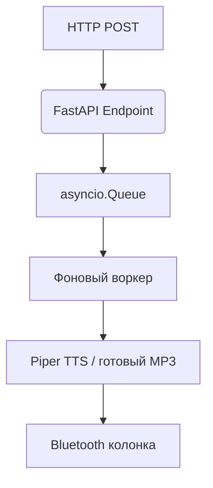

# BT Player — FastAPI сервис для воспроизведения аудио на Bluetooth‑колонках

Сервис принимает HTTP‑запросы, ставит задачи в очередь, синтезирует речь (Piper TTS) или проигрывает готовые MP3, затем отправляет звук на указанную Bluetooth‑колонку через bluealsa + aplay.

## Архитектура



* **Мгновенная постановка в очередь:** запрос возвращается сразу после добавления задачи в `asyncio.Queue`.
* **Последовательная обработка:** воркер берёт задачи по одной, чтобы избежать наложения звука и конфликтов аудио-интерфейса.
* **Блокирующий инференс Piper:** выполняется в фоновом потоке, не блокируя основной асинхронный цикл API.

## Структура проекта

```text
/opt/bt-player/
├── speakers.conf               # Конфигурация колонок: MAC, громкость, профили
├── main.py                     # Точка входа FastAPI, lifespan, динамический импорт плагинов
├── core.py                     # Ядро: очередь задач, фоновый воркер
├── config_manager.py           # Парсинг и валидация speakers.conf
├── utils.py                    # Утилиты: BlueZ/D-Bus, управление громкостью, mpg123
│
├── models/                     # Модели Piper TTS
│   ├── voice.onnx
│   └── voice.onnx.json
│
├── mp3/                        # Статические аудиофайлы умного дома
│   └── audiofiles.mp3
│
└── endpoints/                  # Плагины (динамические роутеры)
    ├── __init__.py
    ├── universal.py            # Универсальный плагин (любой текст/файл)
    ├── neo.py                  # Логика для колонки Neo
    ├── mini.py                 # Логика для колонки Mini
    └── mini_radio.py           # Дополнительные плагины
```

## Требования и зависимости

* Python 3.10+
* FastAPI + Uvicorn
* BlueZ + D-Bus (для управления Bluetooth)
* bluealsa
* aplay (проигрыватель)
* lame (конвертация WAV → MP3)
* Piper TTS (Python‑обёртка)
## 
* Предварительно настроенные bluez и bluealsa — для управления Bluetooth-устройствами и трансляции звука через профиль A2DP
* Заранее нужно сделать сопряжение устройств через bluetoothctl
* pair 00:00:00:00:00:00
* trust 00:00:00:00:00:00
* connect 00:00:00:00

### Установка системных пакетов (Debian/Ubuntu):

```bash
sudo apt update
sudo apt install -y bluez bluealsa alsa-utils
```

### Python‑зависимости (пример requirements.txt):

```text
fastapi
uvicorn
pydantic
```

## Быстрый тест из консоли

### 1. Синтез речи и воспроизведение:

```bash
echo "Проверка работы через консоль" | /opt/bt-player/venv/bin/piper --model /opt/bt-player/models/voice.onnx --output_file - | aplay -D bluealsa:DEV=54:F2:9F:0B:48:BC,PROFILE=a2dp
```

## API Эндпоинты

### Воспроизведение готового MP3

* **Эндпоинт:** `/play`
* **Метод:** `POST`
* **Описание:** Файл ищется по пути `/opt/bt-player/mp3/<filename>.mp3`.

```bash
curl -X POST "http://ip:port/play" \
  -H "Content-Type: application/json" \
  -d '{
       "speaker": "mini",
       "filename": "kettledone"
      }'
```

### Синтез речи и воспроизведение

* **Эндпоинт:** `/say`
* **Метод:** `POST`
* **Описание:** Текст синтезируется «на лету» через Piper TTS, преобразуется и проигрывается.

```bash
curl -X POST "http://ip:port/say" \
  -H "Content-Type: application/json" \
  -d '{
       "speaker": "mini",
       "text": "Чайник вскипел."
      }'
```

### Кастомные уведомления (плагины)

* **Эндпоинт:** `/notify/<name>`
* **Метод:** `POST`
* **Описание:** Логика шагов и кастомное поведение определяются внутри динамических плагинов (например, `endpoints/mini_radio.py`).

```bash
curl -X POST "http://ip:port/notify/kettlemini"
```
* **Эндпоинт:** `/status/health`
*  **Метод** `POST`
*  **Описание:** Проверка состояния (`endpoints/health.py`)
  ```bash
curl -X POST http://ip:port/status/health
```

## Поведение колонок по умолчанию

* **mini**: Перед воспроизведением системная громкость автоматически устанавливается на `5`, а после завершения — возвращается на `3`.
* **neo**: Громкость на уровне ОС не изменяется, выполняется только непосредственное воспроизведение потока.

## Установка
* chmod +x setup.sh
* ./setup.sh
* 
## Пример использования
* Вскипел чайник, в автоматизации home assistant при температуре чайника больше 95° и состояние чайника включено вызываем shell_command с curl запросом, который вызовет endpoint с заранее подготовленным mp3 файлом на колонку например VK по bluetooth
* и т.д.

##
* Протестировано на orange pi zero 3, armbian (trixie)
